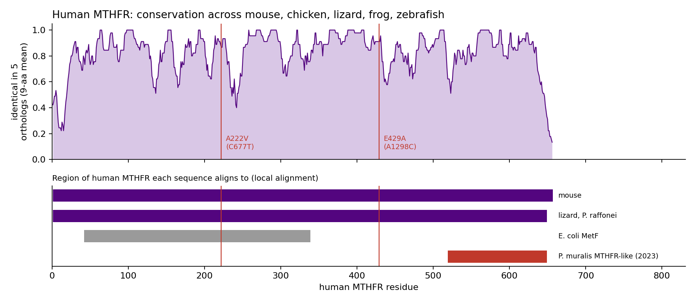
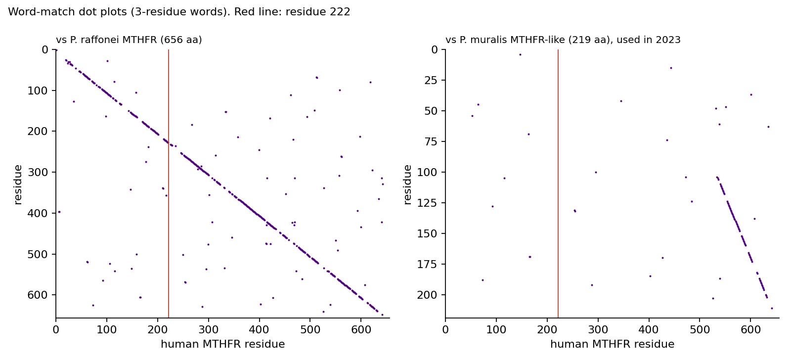

# How conserved is the residue behind MTHFR C677T?

MTHFR C677T (rs1801133) is one of the most studied variants in clinical genetics. It changes
alanine 222 of the folate enzyme MTHFR to valine (A222V), and it is linked in the literature to
raised homocysteine and a long list of conditions. This repository asks a narrower,
checkable question with sequence alignment:

**Is alanine 222 conserved across vertebrates, and how deep does that conservation go?**



## Result

| | Residue at human 222 | Residue at human 429 | Global identity to human |
|---|---|---|---|
| Human (NP_005948.3, 656 aa) | **A** | **E** | |
| Mouse | A | E | 90% |
| Chicken | A | E | 83% |
| Aeolian wall lizard (*Podarcis raffonei*) | A | E | 81% |
| Western clawed frog | A | E | 80% |
| Zebrafish | A | E | 77% |
| *E. coli* MetF (296 aa, local alignment) | **A** (its residue 177) | no counterpart | 34% over human 42 to 338 |

- **A222 is identical in every species tested, from zebrafish to human, and also in *E. coli*.**
  Conservation within vertebrates alone proves little, because 66% of human MTHFR positions are
  identical across all five vertebrates. The stricter test is the bacterial enzyme. Inside the
  297 residues *E. coli* MetF aligns to, only 87 positions (29%) are identical from bacteria to
  human, and A222 is one of them.
- **The alignment finds the bacterial residue on its own.** Human A222 lines up with *E. coli*
  **A177** (motif `VSAGAD` / `VDAGAN`). That is the residue Guenther et al. mutated in 1999 to
  model the human variant. Their A177V enzyme was thermolabile, like human A222V. The aligner
  reached the same position without being told.
- **E429 (A1298C, rs1801131)** is identical in all five vertebrates but has no counterpart in
  *E. coli*. The bacterial enzyme aligns only to human residues 42 to 338, the catalytic part.
  Residue 429 lies beyond that, in the C-terminal regulatory region. That SAM-binding domain
  is eukaryote-only (Froese et al. 2018).

Conservation is evidence that a position matters to the enzyme. It does not measure the
clinical effect of the variant. That evidence comes from the biochemistry and the
epidemiology, not from this analysis.

## The 2023 comparison could not have seen it

This began as a 2023 *Bioinformatics* assignment: align human MTHFR with the gene from another
species and interpret the similarity. The lizard sequence used then was NCBI's
`LOC114590064`, labelled *methylenetetrahydrofolate reductase-like*, from the common wall lizard
*Podarcis muralis*.



That record is a 219-residue fragment, not the lizard's MTHFR. Its alignment covers only human
residues 519 to 648, about 20% of the protein, and it contains **neither variant position**. In
the current RefSeq annotation, *P. muralis* has only fragmented "MTHFR-like" records, the
longest of 382 residues. Its sister species *P. raffonei* has a complete 656-residue MTHFR,
which is used here as the lizard ortholog.

The lesson is general: check that a sequence is the ortholog, and that it covers the region in
question, before reading anything into a similarity score.

## Method

- **Sequences:** protein RefSeq records from NCBI, listed in
  [`data/mthfr_proteins.fasta`](data/mthfr_proteins.fasta). Every length was checked against
  NCBI's own record. `scripts/fetch_sequences.py` re-downloads them and diffs the result.
- **Alignment:** Needleman-Wunsch (global) and Smith-Waterman (local) with affine gaps
  (Gotoh), written from scratch in [`mthfr/align.py`](mthfr/align.py). Scoring is BLOSUM62 with
  gap open -10 and extend -0.5, the EMBOSS defaults. Vertebrate orthologs are aligned
  globally. The 2023 fragments and *E. coli* are aligned locally, because they are not
  full-length homologs.
- **Verification:** 25 randomised tests compare both aligners' scores with Biopython's
  `PairwiseAligner`, and check that every traceback rescores to its reported score and rebuilds
  its input sequences. Each alignment in the analysis is also cross-checked against Biopython
  at run time.
- **Conservation:** every ortholog alignment is projected onto human coordinates. A position
  counts as conserved when the ortholog carries the identical residue.
- **Dot plot:** a 3-residue word-match plot built by hashing. It costs time proportional to the
  sequence lengths plus the matches, instead of calling an aligner once per cell.

## Run it

```bash
pip install -r requirements.txt
python -m mthfr.analysis   # about 20 s, writes results/results.json and figures/
python -m pytest -q        # 30 tests
```

## Limitations

- Five vertebrates and one bacterium is a small panel. A full multiple alignment across
  hundreds of species would give a calibrated conservation score, such as PhyloP or ConSurf.
- Identity is a blunt measure: a conservative substitution counts as a change.
- Pairwise alignments projected onto human coordinates approximate a multiple alignment. They
  are not one.
- Nothing here estimates the clinical effect of either variant.

## References

- B. D. Guenther et al., "The structure and properties of methylenetetrahydrofolate reductase
  from *Escherichia coli* suggest how folate ameliorates human hyperhomocysteinemia," *Nat.
  Struct. Biol.*, vol. 6, pp. 359-365, 1999, doi:10.1038/7594.
- D. S. Froese et al., "Structural basis for the regulation of human
  5,10-methylenetetrahydrofolate reductase by phosphorylation and S-adenosylmethionine
  inhibition," *Nat. Commun.*, vol. 9, 2261, 2018, doi:10.1038/s41467-018-04735-2.
- Sequences: NCBI RefSeq. Accessions are in `data/mthfr_proteins.fasta`.

## Credit

Samuel Henry Mba. This began as a 2023 course assignment (FH Technikum Wien, *Bioinformatics*).
The 2026 analysis, aligners and tests are new.
